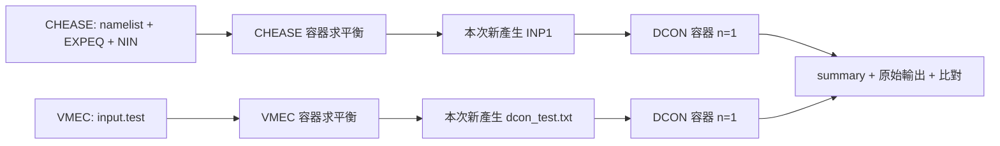

# 兩條獨立流程：輸入、執行、輸出

本套件教的是 **固定輸入 → 真正跑 solver → 檢查收斂 → 新產生介面 → 真正跑 DCON → 比對參考**，不是把保存的 INP1／dcon_test.txt 直接當成這次平衡求解結果。兩條路徑不是互相轉換，也不是相同物理平衡的跨 solver 驗證。



## CHEASE → DCON

範例 `chease_c50`、`chease_c51` 分別來自已封存的 `cl50_000`、`cl50_001`。兩者是同一歷史迭代鏈中不同的固定剖面快照，不是兩個已完成 bootstrap 自洽的穩定解。

- `namelist`：NS=NT=64、NPSI=200、NTNOVA=128、NOPT=-2、EPSLON=1e-10。
- `EXPEQ`：邊界及剖面輸入；`NIN`：restart，不可少。二進位採 FIRST 的 `chease_linliu.x`（有 Lin-Liu 診斷修改），不是聲稱原廠未修改版。
- CHEASE 容器使用 Ubuntu 22 runtime；由 stdin 讀 namelist。
- `run.log`：末次 RESIDU 應不超過 EPSLON，且須有 MKSA 摘要；不能只看 exit 0。
- 新生成 `INP1` 是 Fortran 二進位介面；保留原始 bytes，不用文字編輯器改它。
- DCON 在另一個 Ubuntu 20 runtime 讀 `eq_type="chease"` 與該 INP1。

容器內實際執行的兩個命令（掛載由 runner 準備，勿在原始碼目錄直接跑）：

```sh
# CHEASE container, cwd=/work
exec timeout 300 /opt/solver < namelist
# DCON container, cwd=/work
exec timeout 300 /opt/solver
```

## VMEC → DCON

- `vmec_lowbeta`：本交接新寫的簡單軸對稱、固定邊界、低壓教學輸入；R=1.5m、水平半徑0.5m、垂直半徑0.65m。不是老師 A≈1.2 的目標案例。
- `vmec_smooth`：歷史 `vmec_smooth225/input.test`。電流形狀源於舊平滑處理流程；沒有在本次執行 bootstrap，自洽性不在本例保證範圍。
- 兩者 NTOR=0。FIRST 的 PARVMEC 9.0 patch 才會輸出本套 DCON 介面，不能任意換 upstream VMEC。
- `input.test` → `wout_test.nc`（平衡）、`threed1.test`（診斷）、`dcon_test.txt`（DCON 介面）。
- 最後一層網格的 FSQR、FSQZ、FSQL 都須達到指定容差，並檢查正常結束與 aborting；`ier_flag=0` 本身不足以證明收斂。
- DCON 讀 `eq_type="vmec"` 和新生成的 `dcon_test.txt`。

```sh
# VMEC container, cwd=/work
exec timeout 300 /opt/solver input.test
# DCON container, cwd=/work
exec timeout 300 /opt/solver
```

完整 docker 命令、映像 ID、binary SHA、exit code、耗時都記錄在每次 `summary.json` 的 `stages` 與 `runtime`。兩個階段使用獨立工作目錄與新容器；`dcon/` 的介面檔是從本次 `equilibrium/` 複製，不是從 reference 複製。

## 共同 DCON 條件與限制

- DCON 3.80 既有 binary；n=1，hamada Jacobian，mpsi=mtheta=128。
- psilow=1e-4、psihigh=.99；不是完整磁軸與最邊界驗證。
- delta_mlow=8、delta_mhigh=12；tol_nr=tol_r=1e-8；singfac_min=1e-3、ucrit=10。
- vac.in 保留 ishape=6 的既有 conformal-wall 設定、a=0.2；**不是 no-wall 結論**。幾何細節以保存的 vac.in 及此版本來源為準。
- n=2、3、解析度加密、壁面掃描、完整 ballooning 面覆蓋、bootstrap 閉合與第二穩定分支都不在此小型入門驗收中。

## 「跑對」與「穩定」是兩個答案

`valid=true` 僅表示本套流程必要輸出與門檻通過；`compare.py` 通過再表示與保存的數值／標籤一致。`scientific_acceptance` 一律明列 NOT_CERTIFIED。

DCON 的 `reported_*` 是程式印出的判斷，不是交接者重新證明的物理結論。此版本會留下 IEEE_DIVIDE_BY_ZERO／OVERFLOW／UNDERFLOW 等旗標；旗標會保存並納入比對，不隱藏。若無明確固定邊界判斷字串，`reported_fixed` 是 unknown，不把沒有印 unstable 當成 stable。

NaN／Inf、缺檔、殘差不達標、timeout、ODE 錯誤使工具失敗。對原版有限但有警訊的輸出，本套允許做**可重現的流程教學**，不允許稱「已驗證穩定」。欲取得科學結論，另做數值警訊追因、完整磁面與原生解析度驗證。

## 調整參數時

先複製到新研究 scope，記錄新 input hash、目的、owner 和資源上限；不要修改已接受的 examples/reference。提高 β、變更電流／壁面／模式數會改變物理問題；放寬 FTOL 或比對容差不是修復。此 repository 不自動啟動參數搜尋。

各程式的 beta 定義／正規化可能不同。`equilibrium.beta_vac` 是 CHEASE 的 B0 真空場正規化量；`dcon.betat`、`dcon.betan` 是該版 DCON 診斷，不可把不同路徑的 beta 數字直接當成研究成果排名。參考例的高 βN 不代表達成老師 A≈1.2／高bootstrap／第二穩定分支的聯合目標。
