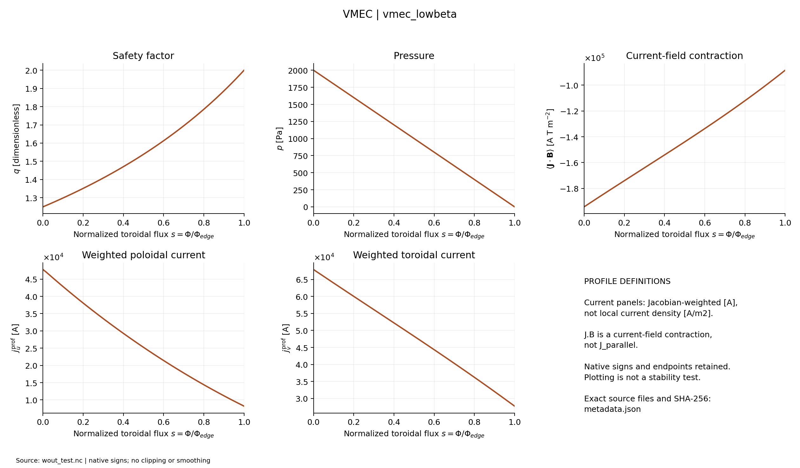
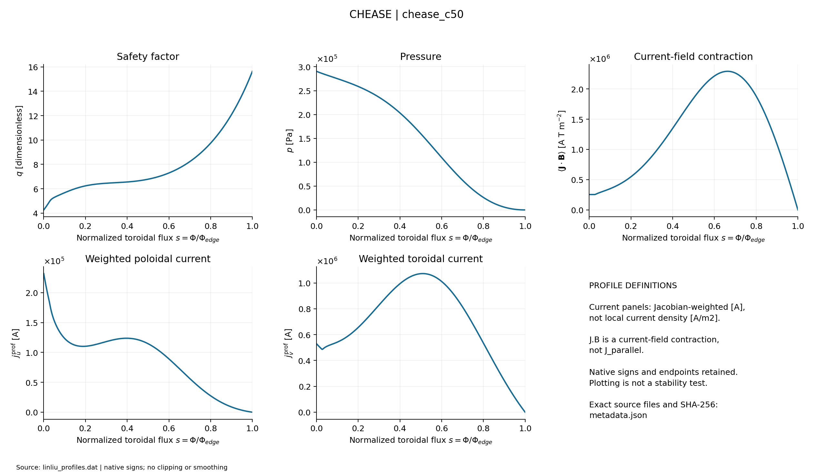
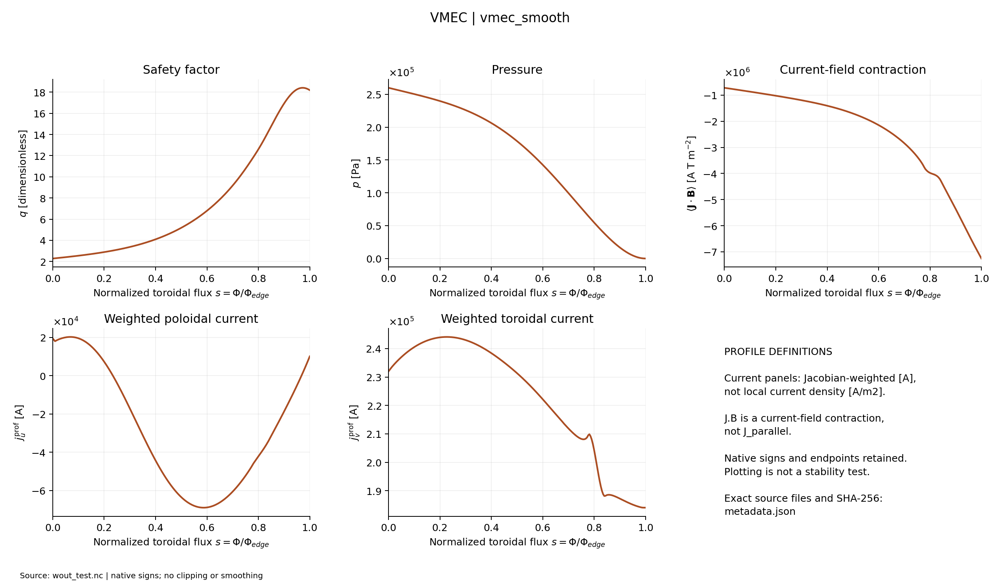
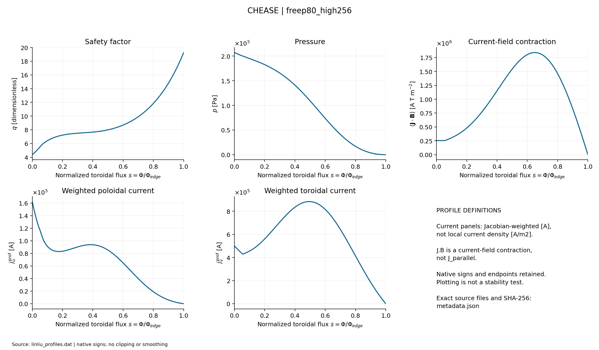
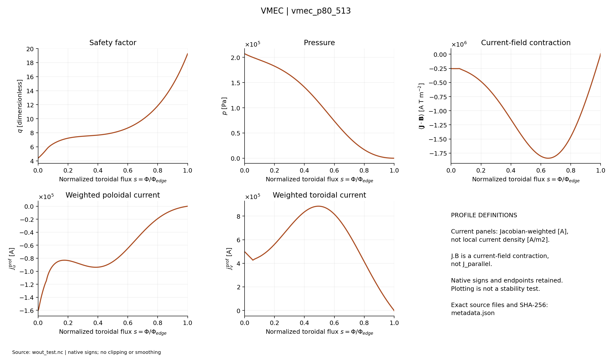
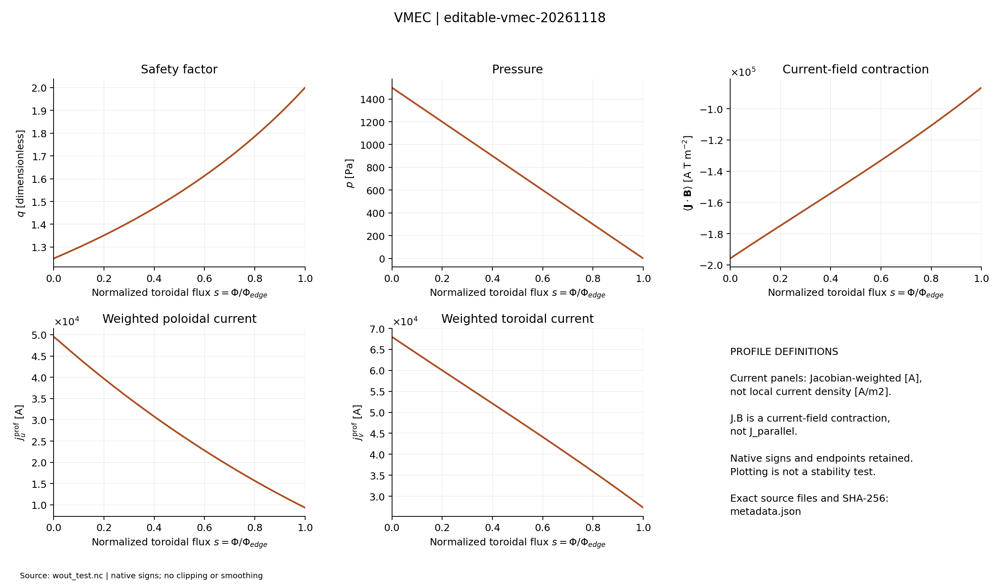
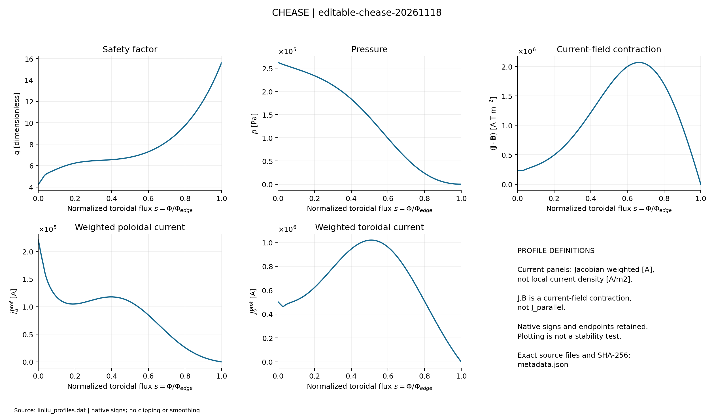
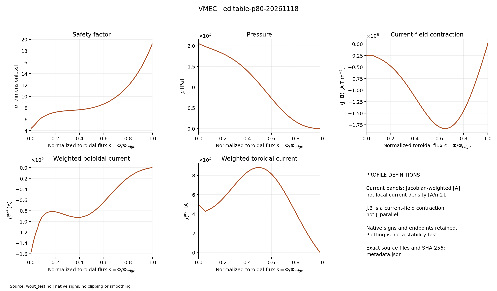

# 本次交接驗收（2026-11-18）

## 範圍與資料

FIRST `ncku-first` / `ouvic`，隔離根目錄 `/home/ouvic/first-handover-20261118`。沒有修改既有 source、binary、排程或容器，沒有啟動參數搜尋。

四個案例各做一輪 reference，再由同一組固定輸入做一輪獨立 replay；兩輪都重新執行平衡 solver 與 DCON。DCON 都是 n=1、指定壁面、psihigh=.99；不是完整科學穩定性驗收。

| 案例 | 平衡收斂指標 | DCON q0 | DCON betan（原生診斷） | reference 管線耗時 |
|---|---:|---:|---:|---:|
| chease_c50 | RESIDU=7.07985e-11 | 4.264 | 8.566 | 約20秒 |
| chease_c51 | RESIDU=9.73762e-11 | 4.281 | 8.452 | 約20秒 |
| vmec_lowbeta | FSQR=9.76e-13；其餘殘差更小 | 1.250 | 0.9089 | 約3秒 |
| vmec_smooth | FSQR=9.92e-14；其餘殘差更小 | 2.279 | 14.17 | 約20秒 |

不同 case 並非同一物理設定，上表不是成果排名。耗時是當時測量，不保證每次相同。正式 machine-readable 比對結果見 `replay_comparison.json`；第二輪實際 summary 在 `replays/`。

## 驗證分層

1. 第一輪：四個 equilibrium 與四個 DCON stage 完成，收斂／介面／必要輸出檢查通過。
2. 第二輪：四條完整管線重跑；比較固定輸入、runtime、DCON 控制檔 hash、關鍵數值、分類及浮點警訊。
3. 參考資料完整性：`reference_manifest.json` 覆蓋44個選定原始輸出／設定／summary；`tools/check_reference.py` 查核 SHA-256。
4. Python 測試：比較公差、缺少欄位、NaN、錯誤schema、false-valid、reference 不可修改；另有平衡未收斂、DCON 致命訊息、缺少固定邊界標記不得推論 stable 等測試。最後執行紀錄見 `acceptance.json`。
5. GitHub CI 僅做靜態工具測試及已存輸出 integrity；不宣稱 CI 新跑了求解器。

## 保留的限制與警訊

所有 DCON reference 都存在 IEEE 浮點旗標；除法／overflow 等不能只因最後數字有限就宣告沒有問題。原始日誌、旗標及 reported 分類完整保存，科學狀態一律 NOT_CERTIFIED。

這是一組可重現的教學／回歸基準，**不是四個已證穩定解**。沒有完成任意 n、全域/局部完整磁面、網格收斂、壁面掃描或 bootstrap 自洽驗證，也沒有修好原版 DCON 的數值警訊。

所有舊研究與失敗輸出保留；本次試跑與驗收容器亦保留為 exited，未執行 rm/prune。

## GitHub 全新取得後再驗證

`clean_checkout.json` 記錄從 GitHub 全新 clone 的 commit，再將該 checkout 精確傳到 FIRST 新目錄。19項工具測試、44份檔案雜湊通過；CHEASE c50 與 VMEC lowbeta 各重新執行整條管線並比對通過。沒有把 GitHub 憑證傳到 FIRST。後續提交只補驗收紀錄，solver 執行工具未改。

## 自動五圖：FIRST 新執行驗收（2026-11-18 14:09–14:16，台北）

已更新兩個 runner：預先查核科學 Python，求解／診斷後自動讀本次輸出繪圖，列出 PNG 總覽與 PDF 路徑；出圖失敗保持 `valid=false`。舊遠端工具先保留在 `backups-profile-20261118T1409/`，未改原 solver、image、歷史案例或排程。

四個教學例全部重新執行 equilibrium → DCON → profiles，四個 reference 比對通過。另對 `freep80_high256` 與 `vmec_p80_513` 重新執行 equilibrium → bootstrap → profiles。六例各有五張單圖，共 **30 張單圖**；每例共15個圖／數值／來源檔案。

已驗證六例來源檔 SHA-256、CSV 全欄逐點符合新輸出、15個必要檔完整，並打開 CHEASE／VMEC 教學與 p80 代表總覽檢查。28項測試在本機及 FIRST 各通過一次；44份 reference 與136份研究輸入雜湊不變。這些是操作／繪圖驗收，不是新的穩定性認證；p80 此次未跑 DCON。

[machine-readable 收據](remote_profile_acceptance.json)

## 可編輯 input（2026-11-18）

新增 `tools/case.py init/run` 與兩 runner 的 `--input-dir`，支援自訂 input 副本、當次快照／hash、修改後自動五圖。三個修改案例已在 FIRST 真正求解，並驗證壓力尺度隨輸入改變；p80 fBS重新計算而非沿用歷史值。原版VMEC低壓例另跑一次回歸通過，本機與FIRST各37項測試通過。

[操作說明](../README.md) · [machine-readable收據](editable_input_acceptance.json)

六例新求解圖（展開查看）

這些圖由 `ouvic@ncku-first` 的新求解輸出自動產生，不是複製 `figures/profiles` 的封存圖。

實跑根目錄：`/home/ouvic/first-handover-20261118`；各案例完整輸出在 `runs/profile-accept-20261118-<case>/`，五張單圖、PDF、CSV 與 metadata 在其 `profiles/` 子目錄。

原始來源是該次 `equilibrium/linliu_profiles.dat` 和 `namelist`（CHEASE），或 `equilibrium/wout_test.nc`（VMEC）。SHA-256、逐點 CSV 檢查及實跑時間見[驗收收據](remote_profile_acceptance.json)；圖形並不構成穩定性認證。

### 四個教學範例

### 高 bootstrap p80：本次重新求解

CHEASE fBS = 99.1602918859%；VMEC fBS = 99.1695246833%。沒有重做外迭代或 DCON，不增加穩定性認證。原生符號保留，沒有將 J·B／極向加權電流取絕對值。

修改 input 的三例圖（展開查看）

FIRST／ouvic，三個全新自訂案例；[完整收據](editable_input_acceptance.json)。結果保留在 `/home/ouvic/first-handover-20261118/runs/<以下案例名稱>/`。每個案例有15個圖／資料／來源檔；所有 input 快照 SHA-256 與可編輯檔一致，CSV逐點符合本次平衡輸出。這不是穩定性認證。

| 自訂案例 | 修改 | 新壓力／原壓力 | 新 fBS |
|---|---|---:|---:|
| editable-vmec-20261118 | PRES_SCALE：2000 → 1500 | 0.75 | 教學流程不計算 |
| editable-chease-20261118 | B0EXP：1 → 0.95 | 0.9025 | 教學流程不計算 |
| editable-p80-20261118 | PRES_SCALE：1 → 0.99 | 0.99 | 98.7676431932% |

p80 不再沿用原始99.1695%，自訂輸入不拿舊參考數字作回歸成功判據。原始 VMEC lowbeta 另做一次不改輸入的回歸，仍通過既有參考比對。本機與FIRST各37項測試通過；44份reference及136份研究輸入雜湊不變。

首次準備 p80 修改時，重複設定檢查發現原檔已有小寫 `pres_scale=1.0`，在任何求解前停止；改為編輯該既有設定後才啟動三例，沒有重複求解或覆寫舊結果。

