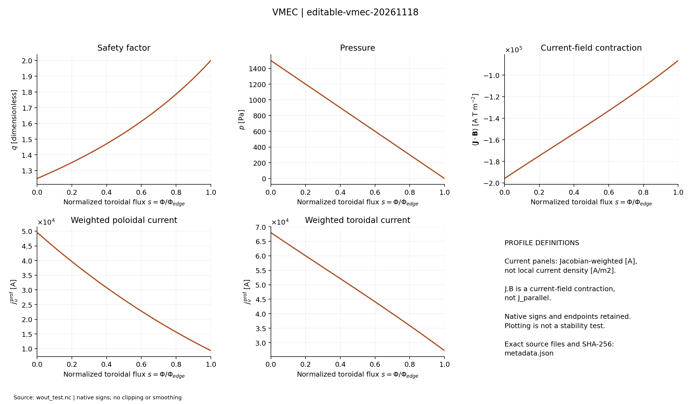
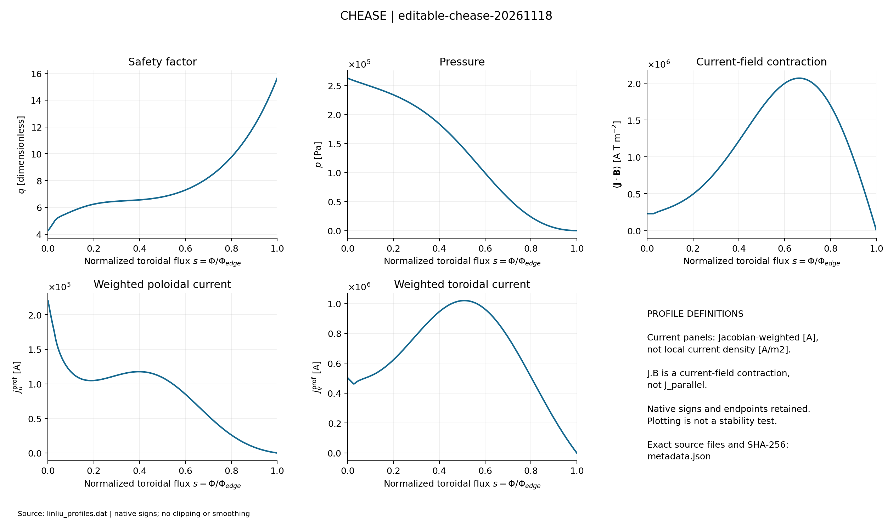
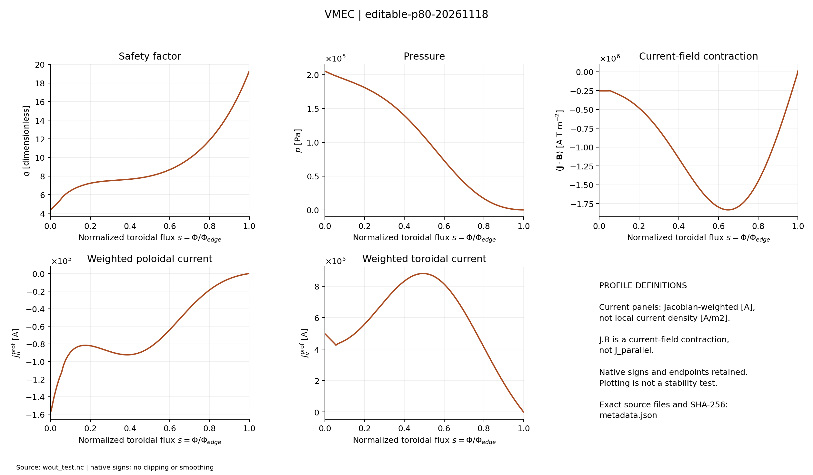

# 修改 input 的遠端實跑驗收

FIRST／ouvic，三個全新自訂案例；[完整收據](../editable_input_acceptance.json)。結果保留在 `/home/ouvic/first-handover-20261118/runs/<以下案例名稱>/`。每個案例有15個圖／資料／來源檔；所有 input 快照 SHA-256 與可編輯檔一致，CSV逐點符合本次平衡輸出。這不是穩定性認證。

| 自訂案例 | 修改 | 新壓力／原壓力 | 新 fBS |
|---|---|---:|---:|
| editable-vmec-20261118 | PRES_SCALE：2000 → 1500 | 0.75 | 教學流程不計算 |
| editable-chease-20261118 | B0EXP：1 → 0.95 | 0.9025 | 教學流程不計算 |
| editable-p80-20261118 | PRES_SCALE：1 → 0.99 | 0.99 | 98.7676431932% |

p80 不再沿用原始99.1695%，自訂輸入不拿舊參考數字作回歸成功判據。原始 VMEC lowbeta 另做一次不改輸入的回歸，仍通過既有參考比對。本機與FIRST各37項測試通過；44份reference及136份研究輸入雜湊不變。

首次準備 p80 修改時，重複設定檢查發現原檔已有小寫 `pres_scale=1.0`，在任何求解前停止；改為編輯該既有設定後才啟動三例，沒有重複求解或覆寫舊結果。

