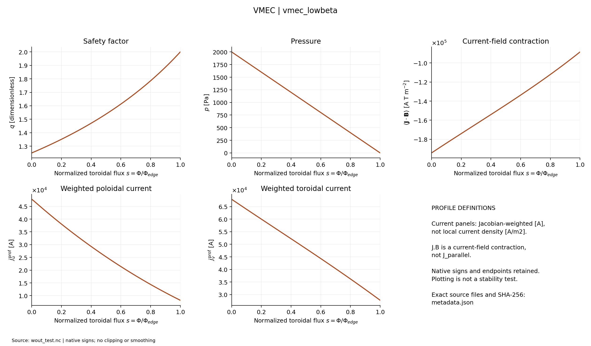
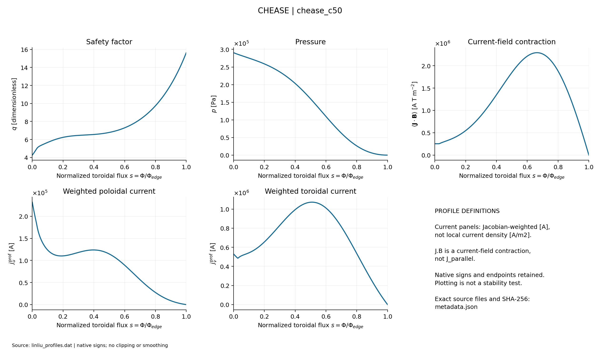
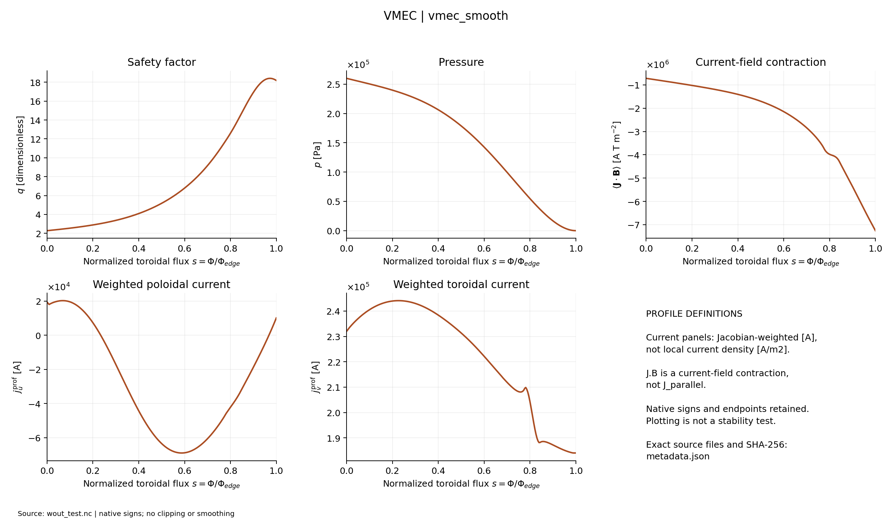
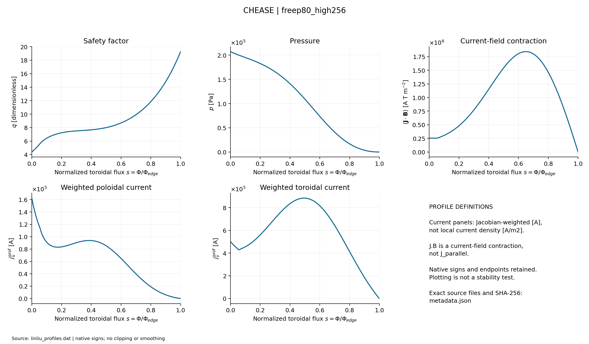
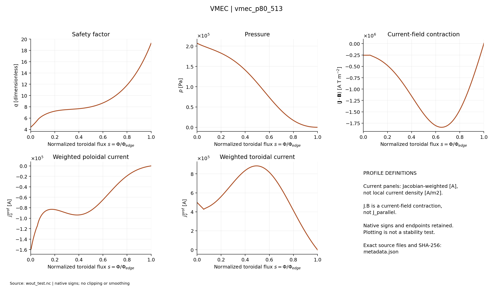

# FIRST 新求解後的五圖總覽

這些圖由 `ouvic@ncku-first` 的新求解輸出自動產生，不是複製 `figures/profiles` 的封存圖。

實跑根目錄：`/home/ouvic/first-handover-20261118`；各案例完整輸出在 `runs/profile-accept-20261118-<case>/`，五張單圖、PDF、CSV 與 metadata 在其 `profiles/` 子目錄。

原始來源是該次 `equilibrium/linliu_profiles.dat` 和 `namelist`（CHEASE），或 `equilibrium/wout_test.nc`（VMEC）。SHA-256、逐點 CSV 檢查及實跑時間見[驗收收據](../remote_profile_acceptance.json)；圖形並不構成穩定性認證。

## 四個教學範例

## 高 bootstrap p80：本次重新求解

CHEASE fBS = 99.1602918859%；VMEC fBS = 99.1695246833%。沒有重做外迭代或 DCON，不增加穩定性認證。原生符號保留，沒有將 J·B／極向加權電流取絕對值。

